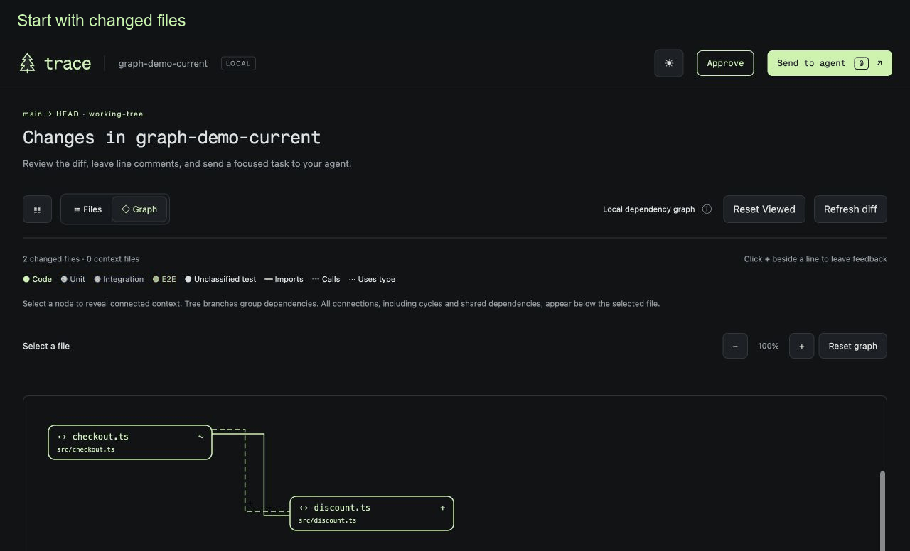

<h1 align="center"> Trace</h1>

Local code review for **Codex and Claude Code**. Explore changes, leave line comments, and get agent replies in the same threads.



## Review changes in context

**Graph starts with changed files. Select a node to reveal connected code and tests, then inspect its diff or source on the right.** Spot changed code whose existing test did not change—and check what that test actually covers.

- **Know which checkout you are reviewing.** See the current branch, the workspace/checkout’s absolute path, and whether it is a linked Git worktree, together with the base and comparison mode for the current diff.
- **Explore freely.** Drag nodes, zoom with a trackpad or buttons, and resize the file preview. Selected nodes are centered without changing zoom.
- **Find Usages in the diff.** Click an identifier, use **Cmd + click**, or press **Option + F7** after selecting it. Choose a result to jump to its file and line.
- **Track progress.** Comment badges stay on nodes. Viewed files leave the graph; **Reset Viewed** restores them. **Reset graph** clears exploration while keeping review progress.
- **Keep the feedback loop open.** Send comments to your agent, read replies, inspect fixes and **Approve**. Approval records confirmation; you can still send another round of feedback afterward.

Graph currently analyzes relative JavaScript/TypeScript dependencies. Find Usages matches identifier names within one side of the diff, so unrelated same-name symbols can appear together. [Graph details](docs/graph.md).

## Install

Requires Homebrew, Git, and Codex or Claude Code.

```sh
brew tap dmydary-code/trace https://github.com/dmydary-code/trace.git
brew trust --formula dmydary-code/trace/trace-review
brew install trace-review
trace-review install all
```

Restart your agent and enable/trust the Trace session hooks (in Codex: `/hooks`). These close the local viewer when its agent session ends; without an active session hook, it remains available while the browser is active and closes after two minutes without a heartbeat or when a detected owning agent exits. In **Codex**, type **`$`** and select the **`review`** skill from the **Trace** plugin, then submit your request. You can also ask **“Use Trace to review my changes.”** In **Claude Code**, run **`/trace:review`**. Or launch directly inside your repository:

```sh
trace-review
trace-review --staged
trace-review --base origin/main --merge-base
```

To update: `brew update`, `brew trust --formula dmydary-code/trace/trace-review`, and `brew upgrade trace-review`, then `trace-review install all` and restart your agent. [CLI and installation details](docs/cli.md).

## License

[MIT](LICENSE) © 2026 dmydary-code. Bundled [fonts](dist/fonts/OFL.txt) and [icons](docs/assets/icons/LICENSE) retain their own licenses.
