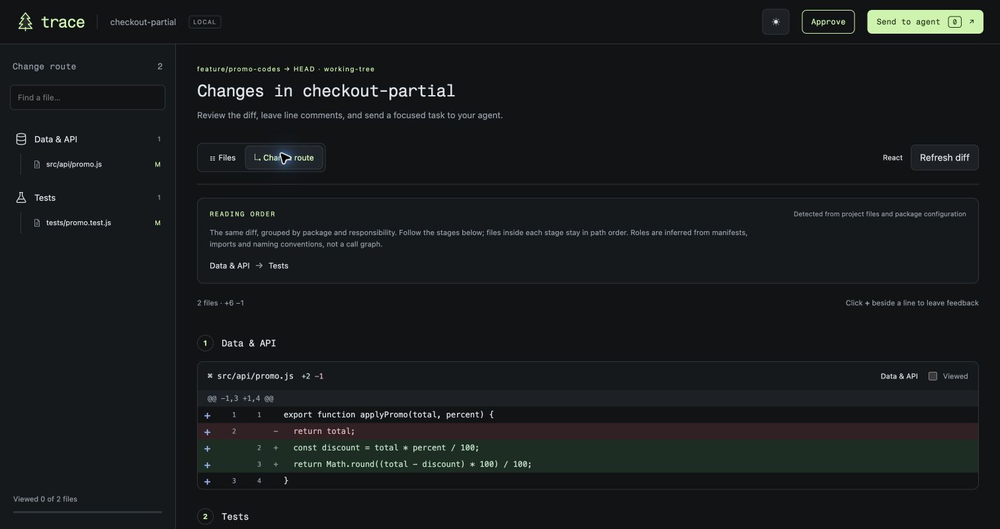
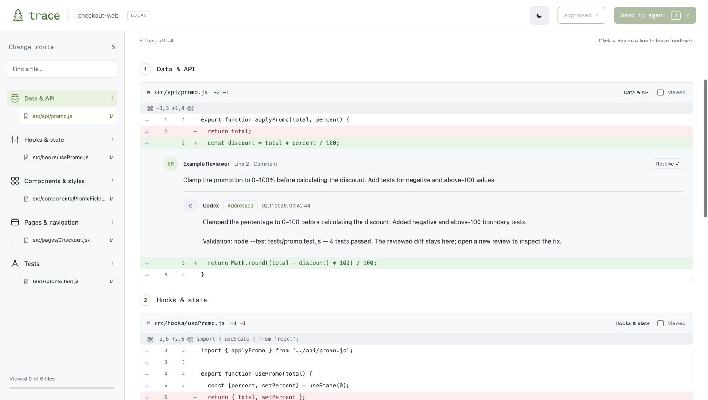

<h1 align="center"> Trace</h1>
<p align="center"><strong>Follow the change, from contract to tests.</strong></p>
<p align="center">Local Git review for Codex and Claude Code.<br>Read changes in a useful order, leave line comments, and get the agent’s answer in the same thread.</p>



*Actual Trace UI on the example checkout repository generated by [this fixture](tests/fixtures/showcase.mjs), with only API and test changes retained to show a partial route. The example is for documentation; your reviews use your own Git changes.*

## The change route

**Files** follows file paths. **Change route** shows the same diff grouped by package and responsibility, so you can read an API change before its state, UI and tests. The left sidebar follows the view: a directory tree in Files, or an icon-led outline of the touched stages in Change route. Only stages containing changed files are shown. Stage links jump within one continuous diff; they do not hide other files.

```text
React     Data & API → Hooks & state → Components & styles → Pages & navigation → Tests
Vue       Data & API → Composables & stores → Components & styles → Pages & navigation → Tests
Angular   Data & API → Services & state → Components & styles → Pages & navigation → Tests
Backend   Contract → Implementation → Consumers → Tests
Mobile    Models → Data → Use cases → Screen state → Screens & navigation → Tests
```

Trace detects the stack per package from nearby manifests, imports, extensions and naming conventions. No framework or architecture selectors are needed. Backend clean/hexagonal and event-flow routes, plus mobile action/reducer routes, are selected when the changed files supply matching role signals. Empty stages are omitted. Files within a stage remain sorted by path.

**Current scope:** this is convention-based ordering, not semantic code analysis or a call graph. It does not prove dependencies or architecture, split one file into multiple roles, or fetch related unchanged code. Unrecognized files stay visible under **Other changes**. If no roles are recognized, the route can look the same as Files. See the [design analysis and limitations](docs/review-routes.md).

### Recognized frameworks and language conventions

The icons below indicate implemented detection and routing heuristics, not full language-server support. A language by itself does not identify an architecture. Plain Git diffs remain readable for other languages too.

| Area | Framework signals | Language conventions | Reading focus |
| --- | --- | --- | --- |
| Frontend |  React<br> Vue<br> Angular |  JavaScript<br> TypeScript | Data, state, components, pages, tests |
| Backend |  NestJS<br> FastAPI<br> Spring |  TypeScript<br> Python<br> Java | Layered services; clean/hexagonal; event flow |
| Mobile |  Android<br> SwiftUI / UIKit<br> Flutter |  Kotlin<br> Swift<br> Dart | State holders / MVVM conventions; actions and reducers |

## Feedback that stays with the code

1. Open Trace from the agent working in your repository.
2. Review the diff, mark files viewed, and add comments beside old or new lines.
3. **Send to agent** returns the feedback to that same conversation.
4. The agent applies the requested change, runs checks, and replies directly under each comment with what changed and what remains unresolved.
5. Check the result and resolve the thread yourself. Use **Review latest changes** to inspect the updated diff, then **Approve** to finish. Approval is tied to the version you inspected and preserves the original threads.



*Documentation walkthrough on the example repository: the boundary fix and four Node tests were run, then the response was recorded through `trace-review reply`. This is a scripted UI verification, not a benchmark of a separate model run.*

Replies have stable review/comment IDs and survive reloads. The saved diff keeps the original line anchors even after code changes. The `--wait` viewer stays available for one hour after submission; `trace-review open --review ID` reopens it later. Agent status labels are reports; only you decide when to resolve a thread.

Reviewer names come from the effective local Git author identity. The interface supports light and dark themes, a fir-tree mark, and [Fragment Mono](dist/fonts/README.md) for headings and accent buttons. Body and code fonts retain their original stacks.

## Install

```sh
brew tap dmydary-code/trace https://github.com/dmydary-code/trace.git
brew install dmydary-code/trace/trace
trace-review install all
```

This repository is currently private. Your Git client needs access. Authenticate with `gh auth login`, then run `gh auth setup-git --hostname github.com` before installing the tap. Codex and Claude Code must be installed and authenticated separately. Use `trace-review install codex` or `trace-review install claude` to install just one integration.

Restart your agent after installation:

- **Claude Code:** run `/trace:review` in your project.
- **Codex:** select Trace’s `review` skill, or ask “Use Trace to review my changes.”

To update: `brew update`, `brew upgrade dmydary-code/trace/trace`, then `trace-review install all` and restart the agent.

## Use from a terminal

```sh
cd /path/to/project
trace-review                                   # Working tree against HEAD
trace-review --staged                           # Staged changes only
trace-review --base origin/main --merge-base    # Local branch / MR-style comparison
trace-review --wait --json --no-open            # Handoff to the calling agent
trace-review feedback --json                    # Recover submitted feedback and replies
trace-review open --review REVIEW_ID            # Reopen saved diff and threads
```

`trace-review` is the primary command; macOS already ships an unrelated `trace` utility. The default review includes staged, unstaged and untracked non-ignored files. Remote refs must already exist locally. Trace does not fetch a hosted PR/MR or publish review comments to GitHub/GitLab.

## Local by default

Trace binds to `127.0.0.1` and stores submitted reviews in the worktree’s Git metadata directory. It validates the revision and line anchors before accepting feedback. The normal workflow returns to the existing agent and does not start another model or upload code. The agent then operates under its own permissions and settings.

Finishing or cancelling a review does not authorize committing, merging or publishing. Closing the browser does not submit feedback. [CLI details, persistence and optional separate Codex mode →](docs/cli.md)

## Development

Node.js 20+ and Git. No runtime npm dependencies or build step.

```sh
npm test
node bin/trace.mjs --repo /path/to/project
claude plugin validate plugins/trace
claude plugin validate .
```

Tests use temporary real Git repositories and cover diff anchors, route detection, stale submissions, persisted replies, concurrent writes, saved snapshots, same-conversation handoff, and the optional Codex adapter with a fixture executable. Tests do not call a live model.

[Route design](docs/review-routes.md) · [CLI reference](docs/cli.md) · [Icon sources and license](docs/assets/icons/README.md)
